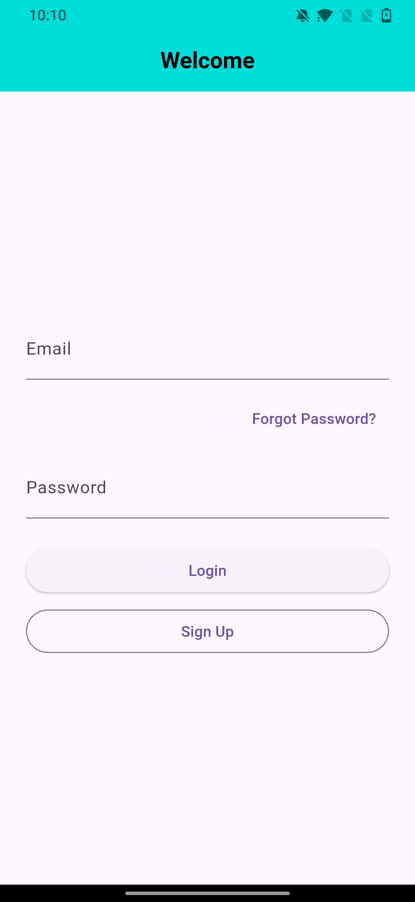
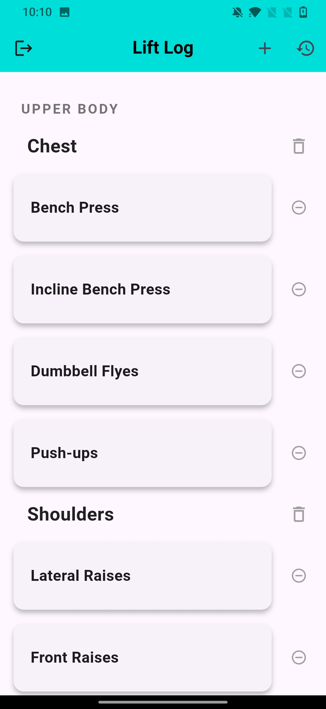
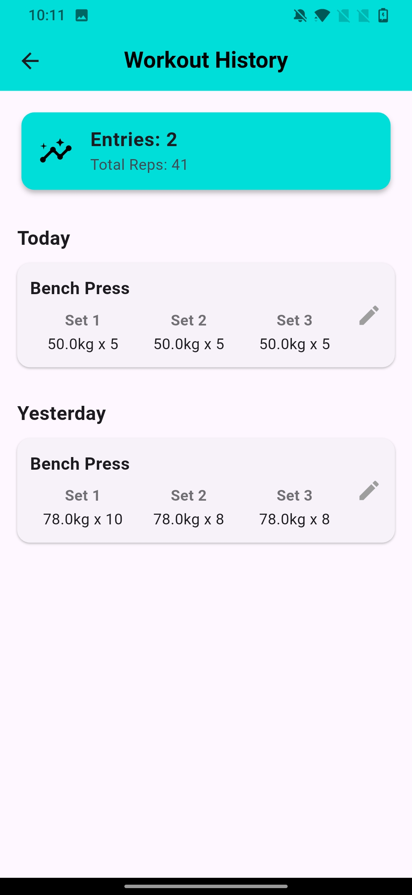

# Lift Log 🏋️

A full-stack workout tracker application built with Flutter and Firebase. This app allows users to create an account, log their workouts with sets and reps, and track their history across multiple devices.

---

## 📸 Screenshots

| Login Screen | Home Screen | History Page |
| :---: | :---: | :---: |
|  |  |  |

---

## ✨ Key Features

- **User Authentication:**
  - Secure sign-up & login with email and password.
  - Email verification to ensure valid users.
  - "Forgot Password" functionality.
- **Cloud Data Storage:**
  - All user data (workout logs, custom exercises) is stored securely in **Cloud Firestore**.
  - Data is tied to the user's account and syncs across devices.
- **Dynamic Exercise Library:**
  - Users start with a comprehensive default list of exercises, grouped by category.
  - Users can add their own custom exercises.
  - Users can delete individual exercises or entire categories.
- **Workout History:**
  - View a complete history of all logged workouts.
  - Edit or delete past workout entries.
  - Intuitive **swipe-to-delete** gesture.

---

## 🛠️ Tech Stack

- **Frontend:** Flutter
- **Backend & Database:** Firebase (Authentication & Cloud Firestore)
- **State Management:** `StatefulWidget` with `setState`
- **Packages:** `firebase_auth`, `cloud_firestore`, `intl`, `shared_preferences`
